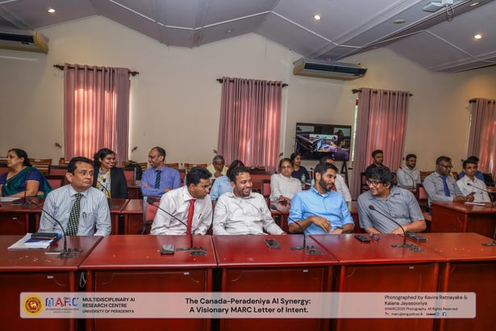
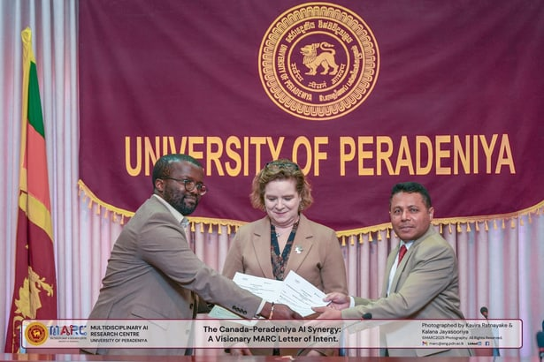
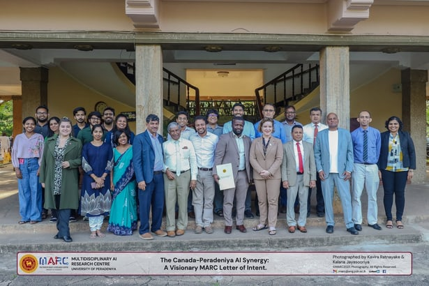

On 24th February 2025, we celebrated the official Letter of Intent (LoI) signing ceremony between the Multidisciplinary AI Research Center (MARC), University of Peradeniya and MedirAI from Canada. This partnership marks a significant milestone in strengthening international collaboration between Sri Lankan academia and the Canadian startup ecosystem.

The agreement was signed by our Vice Chancellor, Professor Terrence Madhujith, and Mr. Jean-François Djoufak, CEO of MedirAI, in the gracious presence of Her Excellency Isabelle Martin, High Commissioner of Canada to Sri Lanka and Maldives, who witnessed the signing.

This milestone was established and organized by Dr. Chathura Withanage (MARC Industry and Digital Economy Centre Lead and Satellite Centre Deputy Director) under the strategic guidance of MARC Director, Prof. Janaka B Ekanayake. By combining MARC's globally recognized expertise in imaging and diagnostics with MedirAI's innovative platforms, we are positioned to bridge the gap between high-impact academic research and industrial applications that improve the accuracy and accessibility of cancer screenings.

We extend our deepest gratitude to Her Excellency Isabelle Martin and Ms. Gwen Temmel of the High Commission of Canada for their instrumental role in fostering these bilateral ties, to Mr. Jean-François Djoufak and the MedirAI team for their commitment to research excellence and shared global responsibility, to the Multidisciplinary AI Research Centre (MARC) for spearheading this vision, and to the University of Peradeniya for providing the vital institutional support to realize this synergy.

This is more than a formal agreement; it is the beginning of a journey to drive impactful AI research on a global scale.

## Photos

