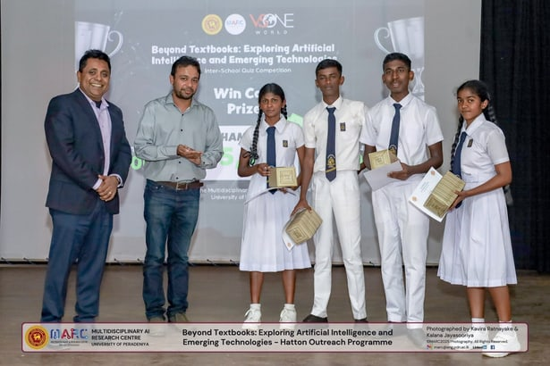
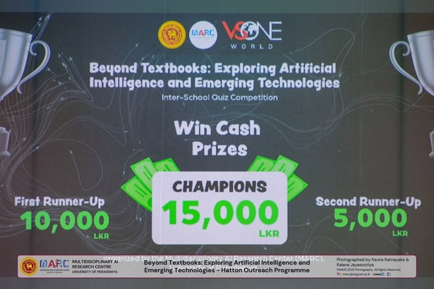
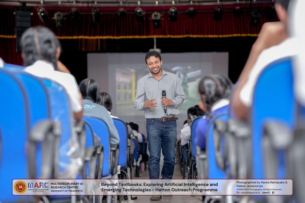

The Multi Disciplinary AI Research Centre conducted another successful 'MARC outreach programme' at the Highlands College Hatton on the 3rd of March 2026.

This enriching workshop was led by our esteemed panel of lecturers, Prof. Janaka B Ekanayake, Prof. Roshan Godaliyadda, Prof. Roshan Ragel, Prof. Mervyn Parakrama Ekanayake, Dr. Asitha Bandaranayake, Dr. S.K. Navaratnarajah, Prof. Saku Yatigammana Ekanayake and Prof. Amalka Pinidiyaarachchi along with the research assistants and volunteers of MARC. The event was concluded with an interactive interschool quiz competition.

We are grateful for the support of the '91 Advanced Level Group of BMMV and VSOne World in making this initiative possible.

## Photos

