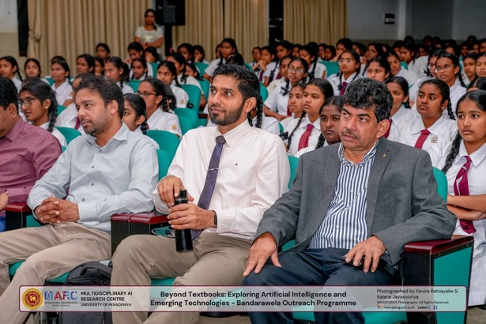
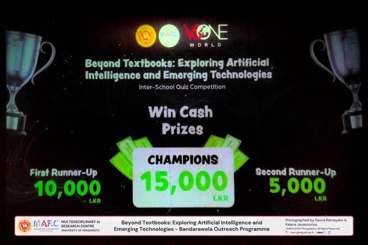
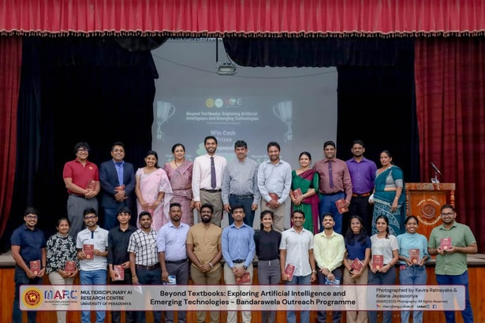

The Multi Disciplinary AI Research Centre conducted another successful 'MARC Outreach Programme' at the Bandarawela Central College on the 4th of March 2026.

This enriching workshop was led by our esteemed panel of lecturers, Prof. Janaka B Ekanayake, Prof. Roshan Godaliyadda, Prof. Mpb Ekanayake, Prof. Roshan Ragel, Dr. Asitha Bandaranayake and Dr. S.K. Navaratnarajah, Prof. Saku Yatigammana Ekanayake and Prof. Amalka Pinidiyaarachchi along with the research assistants and volunteers of MARC. The event was concluded with an interactive interschool quiz competition.

We are grateful for the support of the International Medical Health Organization (IMHO), USA and VSONE World in making this initiative possible.

## Photos

