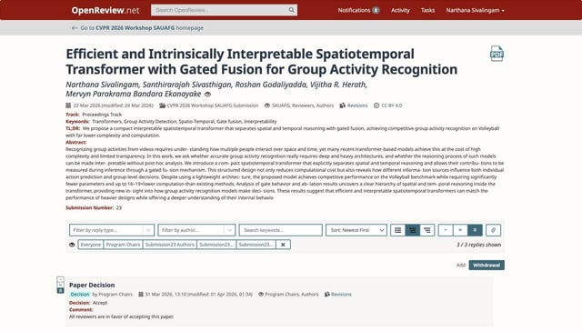

We are thrilled to announce that a breakthrough study from our Computer Vision Research Group has been accepted at the 2nd SAUAFG Workshop (AI-driven Skilled Activity Understanding, Assessment & Feedback Generation) at CVPR Workshops 2026 in Denver, Colorado!

The paper, titled "Efficient and Intrinsically Interpretable Spatiotemporal Transformer with Gated Fusion for Group Activity Recognition," addresses a critical challenge in AI: making complex reasoning both compact and understandable. Our team proposed a transformer model that separates spatial and temporal reasoning using gated fusion, achieving competitive performance while requiring 16–19x less computation.

MARC extends its warmest congratulations to the research team:

- **Lead Researchers:** Narthana Sivalingam and Santhirarajah Sivasthigan.
- **Supervisory Team:** Prof. Roshan Godaliyadda, Prof. Mpb Ekanayake, and Prof. Vijitha R. Herath.

This achievement is a testament to the high-impact synergy between the Multidisciplinary AI Research Centre (MARC) and the Department of Electrical & Electronic Engineering, University of Peradeniya. We are proud to see our students and faculty pushing the boundaries of efficient AI on the global stage.

## Photos

