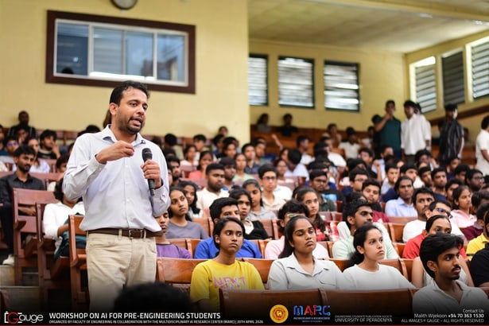
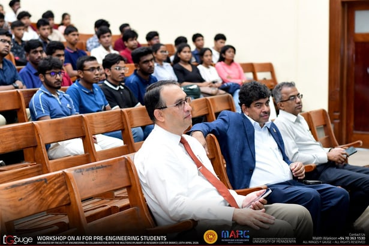

What an incredible day of discovery!

We recently wrapped up the Workshop on AI for Pre-Engineering Students at the University of Peradeniya, and the energy was absolutely unmatched. Hosted by the Multidisciplinary AI Research Centre - University of Peradeniya (MARC), we set out to demystify artificial intelligence and bridge the gap between A/L mathematics and cutting-edge research.

The post-event feedback is in, and we are absolutely thrilled to share the impact:

- **Incredible Reach & Talent:** We welcomed 426 highly motivated attendees representing 290 schools across 20 different districts.
- **Sparking Lifelong Curiosity:** A fantastic 90.5% of respondents told us the workshop inspired them to explore or study AI in the future.
- **Shaping Future Pathways:** 95.2% of participants gained new perspectives on academic opportunities in Sri Lanka, and an overwhelming 95.2% expressed interest in volunteering for future MARC projects!

Thank you to all the brilliant students who brought their curiosity, and to our dedicated alumni, faculty, and research assistants who shared their expertise and journeys. The future of engineering and AI in Sri Lanka is incredibly bright!

A massive thank you to our incredible resource persons and panel for making this event a success: Prof. Lilantha Samaranayake, Prof. Janaka B Ekanayake, Prof. Roshan Godaliyadda, Prof. Mpb Ekanayake, Prof. Vijitha R. Herath, Dr. Asitha Bandaranayake, Dr. Pantaleon Perera, Research Assistants and Volunteers.

## Photos

