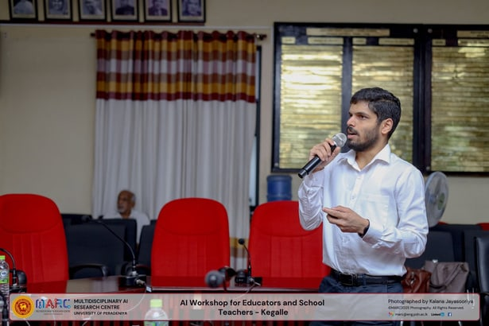
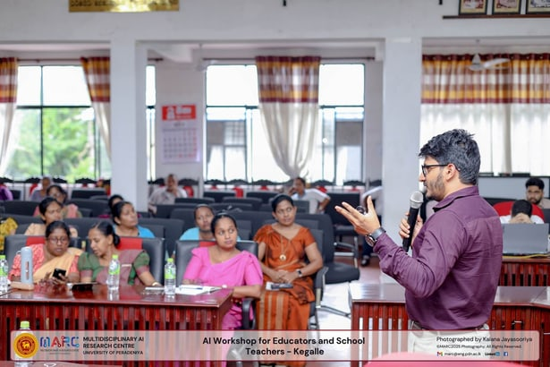
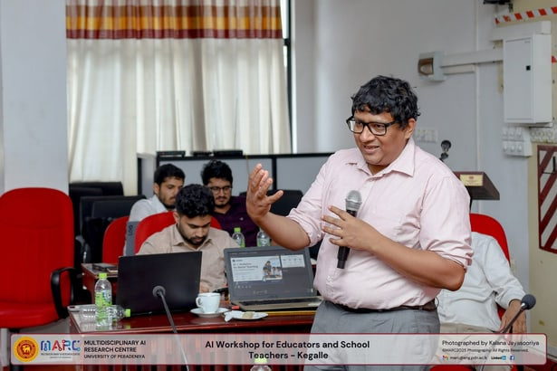

Our team from the Multidisciplinary AI Research Centre at the University of Peradeniya had the wonderful opportunity to be part of a special workshop for school teachers at the Kegalle District Secretariat.

We had the privilege of conducting a session on "Digital Media and Artificial Intelligence." Our goal was to help school media club teachers understand these new technologies so they can improve media literacy in their schools.

This full-day event was a great joint effort by the Department of Government Information and the Kegalle District Secretariat.

The workshop was led by Prof. Roshan Godaliyadda and Prof. Mpb Ekanayake along with the research assistants Dilshara Herath, Pandula Thennakoon, and Athulya Rathnayake.

## Photos

