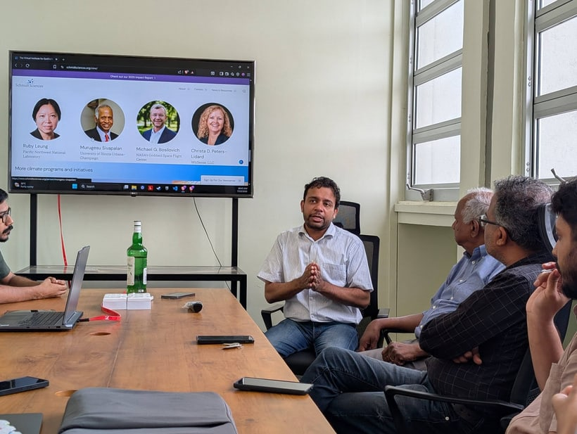
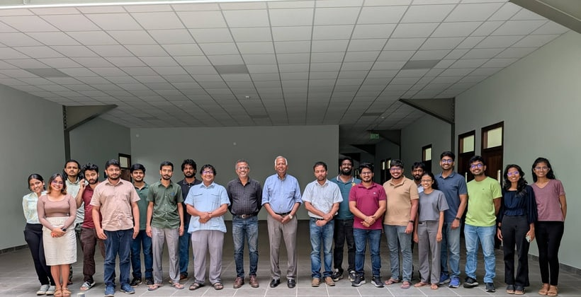

We were deeply honored to host Prof. Murugesu Sivapalan from the University of Illinois Urbana-Champaign at MARC!

Widely celebrated for his groundbreaking contributions to Earth sciences, Prof. Sivapalan is best known for pioneering "socio-hydrology", a discipline that explores the vital connections between human societies and water systems. His visionary research has earned him some of the highest international awards in his field.

We had a highly productive discussion about our ongoing projects and explored exciting pathways to collaborate. Looking forward to seeing where these great conversations lead!

## Photos

