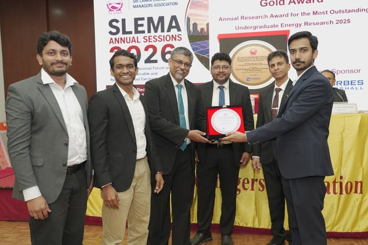
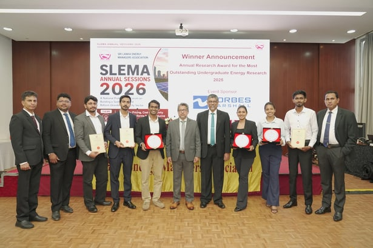

We are incredibly proud to announce that the final-year project "Light Sensing and Control of an Agrovoltaic Plant" from the Department of Electrical and Electronic Engineering, University of Peradeniya in collaboration with MARC has secured First Place and the Gold Award at the SLEMA Annual Research Awards for Most Outstanding Undergraduate Energy Research 2026!

This innovative project explores an intelligent phenotyping system, Ceylon Tea crop modeling, and a light control framework. It successfully balances solar energy generation with agricultural cultivation, sustainably integrating energy production without compromising plant growth.

**Student Team:** Buwaneka Epakanda, Tharinda Navarathne, and Thevindu Samarasekera

**Supervisors:** Prof. Janaka Ekanayake, Prof. Roshan Godaliyadda, Prof. Mpb Ekanayake, and Prof. Vijitha Herath

Special thanks to the Tea Small Holdings Development Authority for their crucial fieldwork support, and PEFAA for their vital financial backing. We also thank the Asian Development Bank and Tiec Pvt. Ltd. for the agrovoltaic pilot project, alongside our external supervisors, Prof. Lasantha Weerasinghe and Prof. Gehan Jayasuriya.

Excellent work pushing the boundaries of sustainable energy and agriculture!

## Photos

