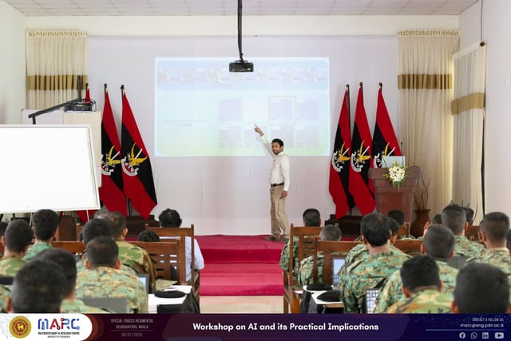
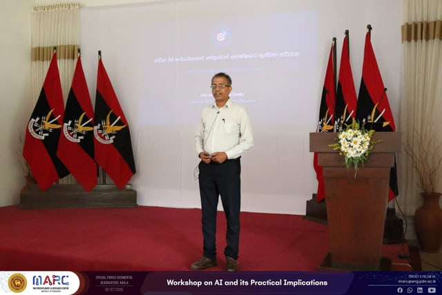

We are deeply honored that MARC was invited to conduct an exclusive workshop on Artificial Intelligence and its practical implementations for the Special Forces of the Sri Lanka Army. Organized under the leadership of Major General Kanchana Weerasekara, this highly engaging session took place on July 30th at the Special Forces Regimental Headquarters in Naula.

The comprehensive workshop was led by our esteemed faculty, Prof. Vijitha Herath, Prof. Mpb Ekanayake, and Prof. Roshan Godaliyadda, alongside our dedicated Research Assistants Pandula Thennakoon, Athulya Rathnayake and Buwaneka Epakanda from MARC.

It was an absolute privilege to share cutting-edge AI knowledge and explore strategic, real-world applications with such an elite unit. A special thank you to the Sri Lanka Army Special Forces for this remarkable opportunity to collaborate and innovate together!

## Photos

